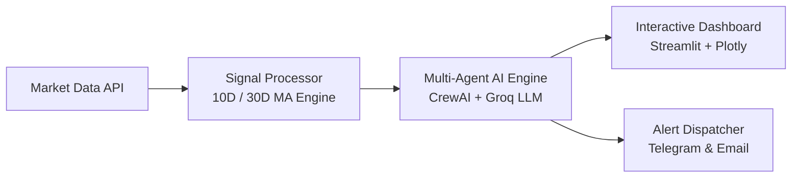

# 🏹 QuantoraPro

### *AI-Driven Equity Signals & Multi-Agent Market Intelligence*


QuantoraPro is an end-to-end financial analytics dashboard that ingests real-time stock data, calculates moving average crossover signals, and coordinates specialized AI agents to generate concise market briefings and automated alerts.

---

## 🏗️ System Architecture



---

## ⚡ Key Capabilities

* **Real-Time Data Ingestion:** Pulls intraday and historical equity prices via external REST endpoints.
* **Quantitative Signal Engine:** Computes 10-day and 30-day moving average crossovers to detect momentum shifts.
* **Multi-Agent Briefing Pipeline:** Uses CrewAI agents powered by Groq-hosted Llama models to synthesize market context into short executive summaries.
* **Automated Multi-Channel Alerts:** Dispatches instant signal notifications to Telegram chats and email recipients.
* **Interactive Visualization:** Renders responsive dashboard cards and dynamic candlestick/trend charts using Streamlit and Plotly.

---

## 🛠️ Technology Stack

* **Interface & Charts:** Streamlit, Custom CSS, Plotly
* **Data & Analytics:** Python, Pandas, Requests
* **Agent Orchestration:** CrewAI, Groq Inference API
* **Notifications:** Telegram Bot API, Python `smtplib`

---

## 🚀 Local Setup & Installation

### 1. Clone the Repository
```bash
git clone https://github.com
cd QuantoraPro
```

### 2. Create a Virtual Environment & Install Dependencies
```bash
python -m venv venv
source venv/bin/activate  # On Windows: venv\Scripts\activate
pip install -r requirements.txt
```

### 3. Configure Environment Variables
Create a `.env` file in the project root (and ensure `.env` is listed in your `.gitignore`):

```env
ALPHA_VANTAGE_API_KEY=your_market_api_key
GROQ_API_KEY=your_groq_api_key
TELEGRAM_BOT_TOKEN=your_telegram_bot_token
TELEGRAM_CHAT_ID=your_target_chat_id
SMTP_HOST=://smtp.gmail.com
SMTP_PORT=587
SMTP_USER=your_email@example.com
SMTP_PASSWORD=your_app_password
```

### 4. Launch the Application
```bash
streamlit run Quantora.py
```

---

## 🐳 Container Deployment (Optional)

To run QuantoraPro inside a container for cloud deployment on Azure Container Apps or Oracle Cloud Infrastructure:

```bash
docker build -t quantorapro:latest .
docker run --env-file .env -p 8501:8501 quantorapro:latest
```

---

## ⚠️ Disclaimer

This software is built for educational and portfolio demonstration purposes only and does not constitute financial or investment advice.
